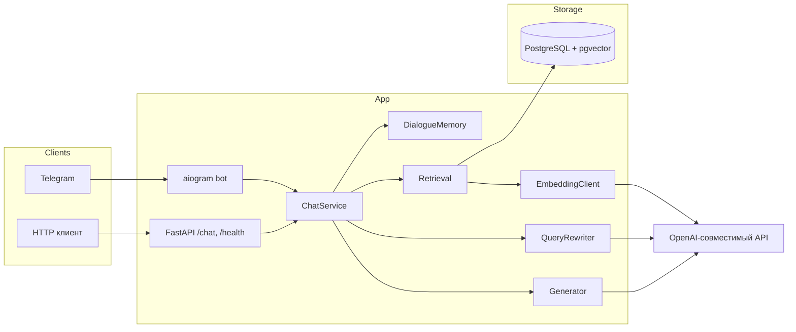

# DocsBot

RAG-сервис, который отвечает на вопросы по базе знаний (документация открытого
проекта в Markdown). Ответ генерирует LLM **только на основе найденных
фрагментов** и обязательно со ссылками на источники. Бот всегда отвечает
на русском языке, а если в базе нет ответа — честно сообщает об этом.

## Возможности

- Загрузка `.md`-документов: чанкинг по заголовкам, батчевые эмбеддинги,
  идемпотентная загрузка по хэшу файла.
- Поиск по косинусной близости через PostgreSQL + pgvector (top-k, порог
  релевантности).
- Генерация ответа на русском языке с inline-цитатами `[1]`, `[2]`; системный
  промпт — в файле.
- Диалоговая память и query rewriting для follow-up вопросов.
- REST API (`POST /chat`, `GET /health`) и Telegram-бот (`/start`, `/reset`).
- Оценка качества: Hit@k, Answer accuracy (LLM-судья), Refusal accuracy,
  средняя задержка.

## Стек

Python 3.12 · FastAPI + Uvicorn · PostgreSQL 16 + pgvector · SQLAlchemy 2.x
(async) + Alembic · Pydantic v2 / pydantic-settings · OpenAI-совместимый API ·
aiogram 3 · pytest / ruff / mypy · uv · Docker Compose.

## Архитектура



Слои разделены: `api/`, `bot/`, `services/` (retrieval, generation, memory),
`db/`, `ingest/`, `eval/`. Бизнес-логика живёт в `services/` и не зависит от
FastAPI и aiogram — API и бот вызывают один и тот же `ChatService`.

## Структура

```
app/
├── api/          # FastAPI роуты, схемы, ошибки, rate limit
├── bot/          # Telegram-бот
├── services/     # retrieval, generation, memory, rewriting, chat
├── db/           # модели, сессия, миграции
├── ingest/       # чанкинг, эмбеддинги, загрузка
├── prompts/      # системные промпты (system, rewrite, judge)
└── config.py     # pydantic-settings
eval/             # вопросы, скрипт оценки, результаты
data/docs/        # документация для базы знаний
tests/
docker-compose.yml · Dockerfile · .env.example
```

## Запуск

### 1. Конфигурация

```bash
cp .env.example .env
# заполните LLM_API_KEY (и, по желанию, LLM_BASE_URL / CHAT_MODEL / EMBEDDING_MODEL)
```

Секреты в репозиторий не попадают (`.env` в `.gitignore`).

### 2. Одна команда — Docker Compose

```bash
docker compose up          # API + PostgreSQL
docker compose --profile bot up   # + Telegram-бот
```

API поднимается на `:8000`, при старте прогоняет миграции Alembic.
Телеграм-бот включается, когда в `.env` заданы `TELEGRAM_ENABLED=true` и
`TELEGRAM_BOT_TOKEN`.

### 3. Загрузка документов

```bash
python -m app.ingest --path ./data/docs
```

Повторный запуск идемпотентен: неизменившиеся файлы пропускаются по хэшу,
изменившиеся пересчитываются, удалённые убираются из базы.

### 4. Локальная разработка

```bash
uv sync                                  # venv + зависимости
docker compose up -d db                  # только база
uv run alembic upgrade head              # миграции
uv run python -m app.ingest --path ./data/docs
uv run python -m app                     # API
uv run python -m app.bot                 # бот (опционально)
```

## Примеры запросов

```bash
# Здоровье
curl http://localhost:8000/health
# -> {"status":"ok"}

# Вопрос
curl -X POST http://localhost:8000/chat \
  -H "Content-Type: application/json" \
  -d '{"session_id":"demo","message":"Как загрузить документы?"}'
# -> {
#   "answer": "Выполните python -m app.ingest --path ./data/docs ... [1]",
#   "sources": [{"file":"getting-started.md","section":"Начало работы > Загрузка документов","snippet":"..."}],
#   "latency_ms": 7015
# }
```

## Проверка качества

```bash
python -m eval.run
```

Считает Hit@k, Answer accuracy (LLM-судья по рубрике), Refusal accuracy и
среднюю задержку по `eval/questions.yaml`, пишет `eval/results/<дата>_<время>.json`.

### Метрики

| Изменение | Hit@k | Answer accuracy | Refusal accuracy | Avg latency |
|---|---|---|---|---|
| Базовый замер (порог 0.30, chunk 800/100, k=5) | 100% | 100% | 100% | 8934 ms |
| + query rewriting | 100% | 100% | 100% | 7718 ms |

Замеры выше получены на англоязычной версии базы знаний. После перевода
документации и eval-вопросов на русский язык их нужно пересчитать командой
`python -m eval.run`.

Набор из 30 вопросов (25 в базе, 5 вне базы). Более сложный набор и тюнинг
порога/размера чанка дадут более различающийся замер (см. ниже).

## Тесты и линтеры

```bash
uv run ruff check . && uv run ruff format --check .
uv run mypy app eval
uv run pytest
```

## Что я бы улучшил

- **Гибридный поиск** — объединить векторный поиск с BM25 (full-text),
  чтобы точнее покрывать редкие термины и точные совпадения.
- **Реранкер** — отдельная cross-encoder модель для переранжирования top-k
  кандидатов перед генерацией.
- **Стриминг** — потоковая выдача токенов в `/chat` и Telegram.
- **Память в БД/Redis** — сейчас память диалога in-memory; персистентность и
  TTL дадут горизонтальное масштабирование.
- **Rate limit** — заменить in-memory лимитер на Redis для распределённого
  деплоя.
- **Более сложный eval-набор** и авто-запись метрик в README из результатов.
- **Observability** — трейсинг (OpenTelemetry) и метрики Prometheus.

## Development

Проект использует [uv](https://docs.astral.sh/uv/). Зависимости и версия
Python зафиксированы в `pyproject.toml` / `uv.lock` / `.python-version`.
